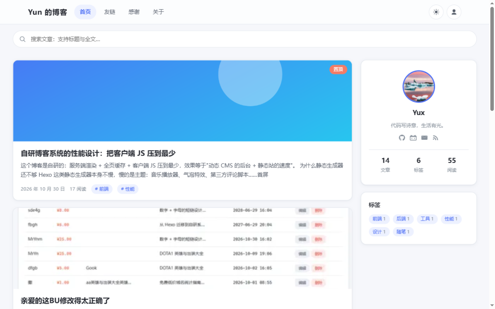
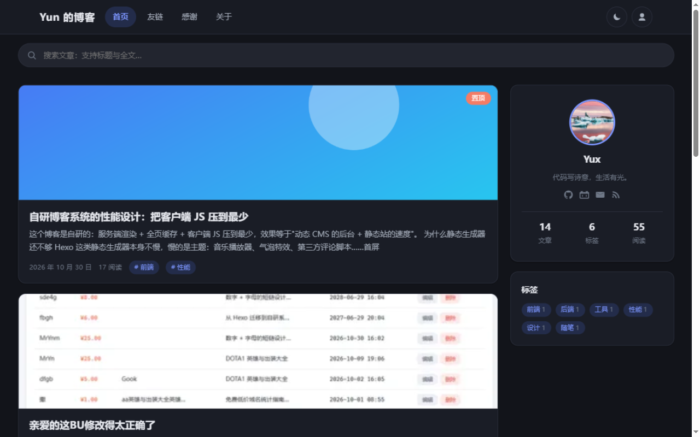
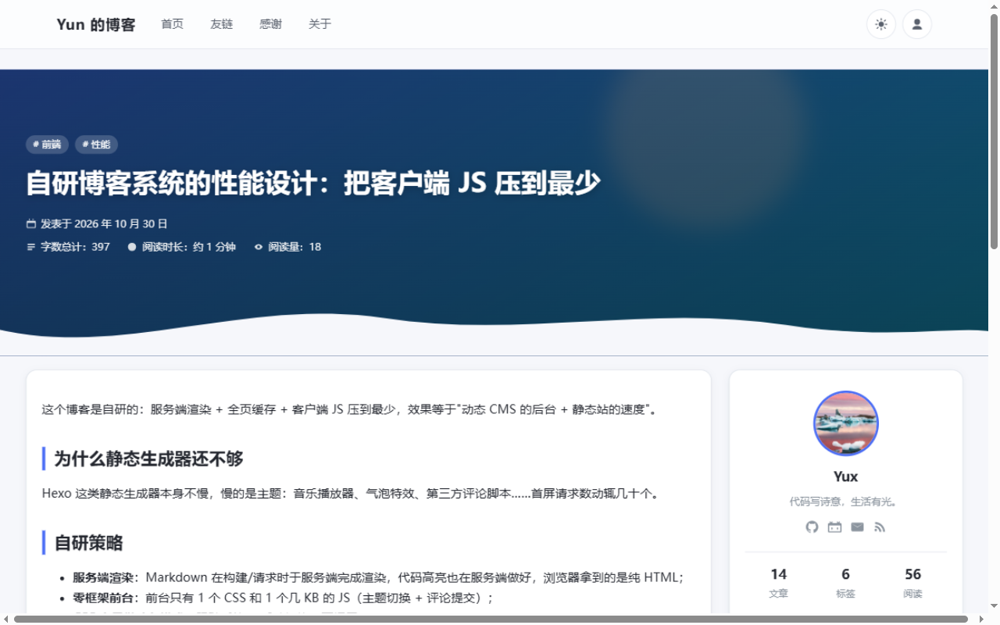
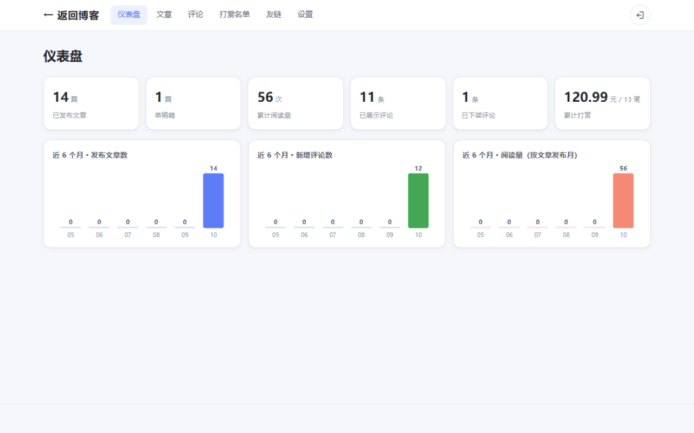
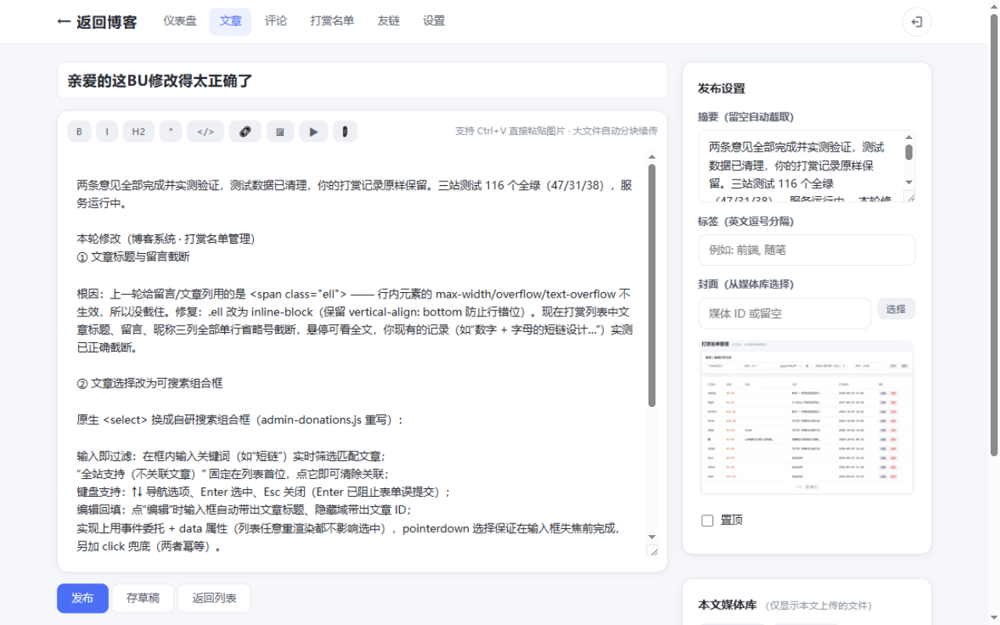

# 自研博客系统

> AnZhiYu 风格 · 服务端渲染 · 极简客户端 JS —— "动态 CMS 的后台 + 静态站的速度"

一个从零自研的博客系统：前台只有 1 个 CSS 和 1 个几 KB 的 JS（无框架、无构建），Markdown 与代码高亮全部在服务端完成；后台具备文章、评论、打赏、友链、站点配置的完整管理能力。功能做减法，性能做加法。

## ✨ 功能特性

### 前台
- 🏠 **首页**：文章卡片列表（每页 10 篇 + 分页）、右侧个人信息卡（头像悬停显示站点描述）、标签云、**导航下方全站搜索**（按标题与全文匹配）
- 📝 **文章详情**：AnZhiYu 风格全宽封面模糊头部 + 白色大标题 + 发布/更新时间、字数统计、阅读时长、阅读量；服务端代码高亮（零客户端高亮库）、TOC 随滚动定位高亮、图片懒加载图注、**图片单击放大灯箱（多图左右切换 / 键盘操作 / 循环浏览）**
- 🙏 **感谢名单页**：打赏者名单（奖牌排序、留言、关联文章，最近 50 条），页内可直接打赏
- 💬 **评论**：发布即展示，转义防 XSS，同 IP 频率限制防灌水
- 🎁 **打赏**：站主信息 + CC BY-NC-SA 4.0 转载声明 + 大尺寸收款码弹层 + 二维码单击放大
- 🌓 **完整深色模式**（跟随系统 + 手动切换）、回到顶部/底部浮钮

### 后台（所有页面登录后才可进入，Cookie 会话守卫）
- 📊 **仪表盘**：清晰文案的统计卡 + 近 6 个月发布文章数 / 评论数 / 阅读量 SVG 柱状图（零依赖）
- ✍️ **编辑器**：Markdown 工具栏 + **Ctrl+V 直接粘贴图片**（自动上传并插入，媒体自动关联本文）+ 拖拽上传 + 视频/附件插入（大文件分块断点续传）
- 🗂 **文章管理**：分页列表、草稿/发布、置顶、**slug 重新生成（旧链自动 301）**
- 💬 **评论管理**：下架 / 恢复 / 删除，分页
- 🎁 **打赏名单管理**：手工录入（昵称 / 金额 / 留言 / 关联文章 / 时间），**可搜索文章组合框**，分页
- 🔗 **友链管理** / 🖼 **媒体库**（图片自动缩略图）
- ⚙️ **站点设置**：站名 / 描述 / 头像（可上传）/ 社交 / 页脚（© 行 + 附加文字 + ICP 同一行）/ 关于页 / 打赏文案与收款码（各自可上传）/ 修改管理员密码 —— 保存后前台即时生效

### SEO 与迁移
- 自动生成 `sitemap.xml` / `robots.txt` / `rss.xml`，文章页 JSON-LD 结构化数据
- **hexo 一键迁移**：解析 front-matter → 本地图资源自动入库并替换链接 → 旧 permalink 全量写入映射表，上线后自动 301 不断链

## 📸 截图

**首页（浅色 / 深色）**：




**文章详情**——全宽封面模糊头部 + 元信息 + 波浪分隔：



**感谢名单页**：


**仪表盘**——统计卡 + 近 6 个月趋势图（零依赖 SVG）：



**编辑器**——Ctrl+V 粘贴贴图，本文媒体库即时回显：



## 🚀 快速开始

```bash
# 环境要求：Node.js ≥ 22.5（内置 node:sqlite）+ sharp / markdown-it 等纯依赖
git clone <your-repo-url> blog
cd blog
npm install
npm start          # 打开 http://localhost:3200
```

首次启动自动创建管理员（可用环境变量覆盖）：用户名 `admin` / 密码 `admin123`

```bash
npm run seed            # 3 篇演示文章 + 友链 + 评论 + 打赏样例（仅空库时生效）
npm test                # 38 个单元 / 接口测试
npm run migrate:hexo -- <hexo根目录>   # hexo 博客一键迁移（可加 --draft）
```

自定义：`PORT=8080 npm start`、`SITE_URL=https://your.domain npm start`（生成正确的 sitemap/RSS 链接）

## 🧱 技术栈

| 层 | 选型 |
|---|---|
| 运行时 | Node.js ≥ 22.5 原生 ESM（零构建步骤） |
| Web 框架 | Express 4 |
| 数据库 | `node:sqlite`（Node 22 内置，11 张表） |
| Markdown | markdown-it + highlight.js（服务端渲染与高亮，客户端不加载任何高亮库） |
| 图片 | sharp（媒体库缩略图） |
| 鉴权 | JWT（`node:crypto` 自实现）+ scrypt + HttpOnly Cookie |
| 上传 | 与图片分享系统同一套分块断点续传组件（4MB/块 · 并发 3 路 · 断点续传 · 秒传） |
| 前台 JS | 仅主题切换 / 代码复制 / 评论提交 / 打赏弹层 / TOC 高亮 / 搜索跳转，合计几 KB |

> 性能设计：服务端完成 Markdown 渲染、代码高亮、TOC 提取、摘要截取；首屏请求 ≤ 10；无 CSS/JS 框架、无字数统计圈等重特效，动画只用 CSS。

## 📁 项目结构

```
blog/
├── server.js               # 入口
├── src/
│   ├── app.js              # Express 装配（前台 SSR / 后台 API / SEO / 上传协议）
│   ├── db.js               # SQLite 数据访问层（users/posts/tags/friends/configs/media/comments/url_maps/donations…）
│   ├── lib/
│   │   ├── markdown.js     # markdown-it 封装：高亮 / TOC / 图注 / 视频与附件渲染扩展
│   │   ├── slug.js         # 8 位随机 slug（剔除易混字符，约 10¹² 组合）
│   │   ├── configs.js      # 配置中心（键值表 + 默认值合并）
│   │   ├── uploader.js     # 分块断点续传会话管理（与图片分享系统同源）
│   │   ├── frontmatter.js  # hexo front-matter 解析器
│   │   └── auth.js         # scrypt + JWT（零依赖自实现）
│   ├── migrate-hexo.js     # hexo 迁移脚本（front-matter → 媒体入库 → 旧链 301）
│   └── views/              # 前台 + 后台 SSR 模板
├── public/
│   ├── css/app.css         # AnZhiYu 风格主题（CSS 变量 + 深色模式）
│   └── js/                 # 前台极小脚本 + 后台管理脚本 + 上传组件
├── tests/                  # 41 个单元 / 接口测试
├── docs/screenshots/       # README 截图
└── data/                   # 运行数据（首次运行自动创建，已在 .gitignore 排除）
    ├── blog.db             # SQLite 数据库：文章 / 评论 / 打赏 / 友链 / 站点配置 / 媒体索引等
    └── uploads/            # 上传的媒体文件（图片原图与缩略图、视频、附件，按内容 hash 寻址）
```

> **数据安全**：`data/` 目录包含全部文章与媒体文件，请勿提交到 Git；备份时整目录拷贝即可完整迁移。

## 🔌 API 摘要

```
POST /api/admin/login                        登录（JWT + Cookie 会话）
GET/POST/PATCH/DELETE /api/admin/posts…      文章 CRUD（分页）
POST /api/admin/posts/:id/regenerate-slug    重新生成 slug（旧 slug 301）
GET/POST/PATCH/DELETE /api/admin/donations…  打赏名单管理（分页）
PATCH  /api/admin/comments/:id               评论下架 / 恢复
GET/PATCH /api/admin/configs                 站点配置读写
POST   /api/posts/:slug/comments             发表评论（自动展示 + 限流）
GET    /sitemap.xml /rss.xml /robots.txt     SEO 端点
POST   /api/upload/*                         分块断点续传（图片/视频/附件）
```

## ✅ 测试

```bash
npm test
```

38 个测试覆盖：slug 唯一性与 301 重定向、**Markdown XSS 防护**（内联 HTML 转义）、TOC 提取、视频/附件渲染扩展、评论发布即展示与下架隐藏、评论频率限制 429、打赏 CRUD 与感谢页、站内搜索、后台 Cookie 守卫 302、媒体按文章过滤（关联 ∪ 正文引用）、密码修改后旧密码失效、hexo front-matter 解析、月度统计等。

## 📄 License

MIT
